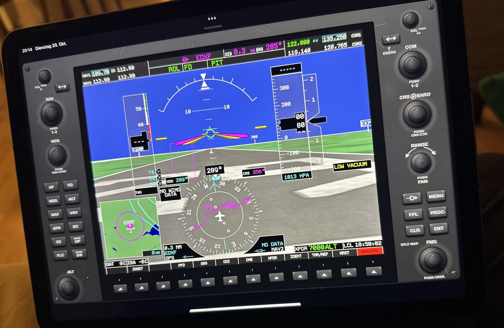
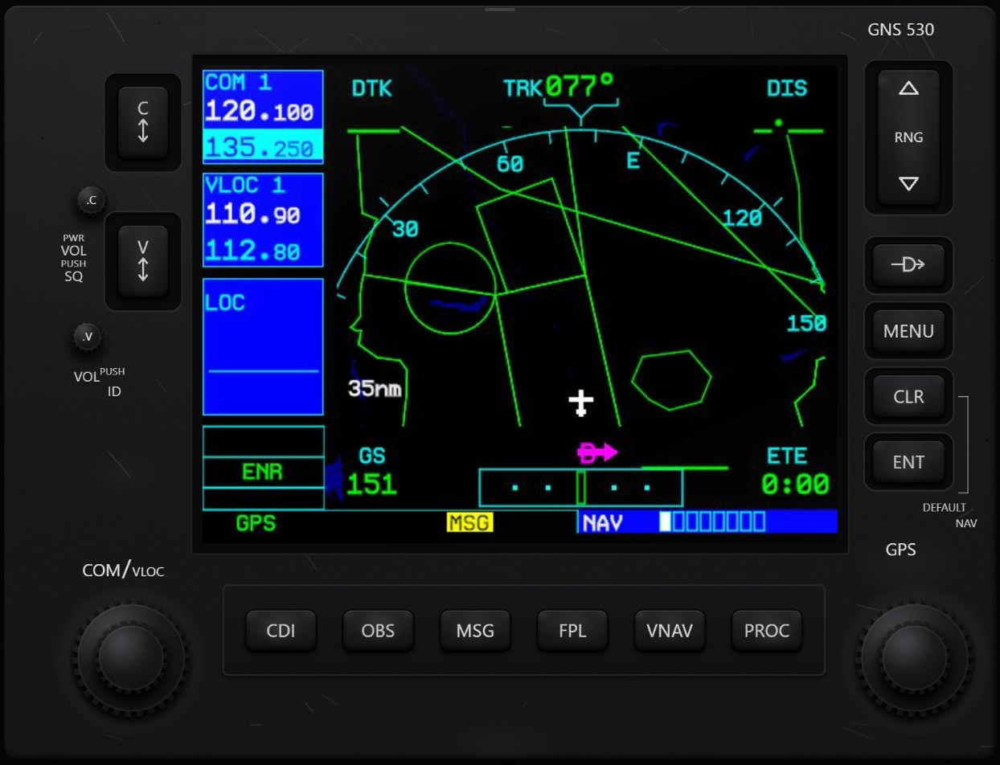
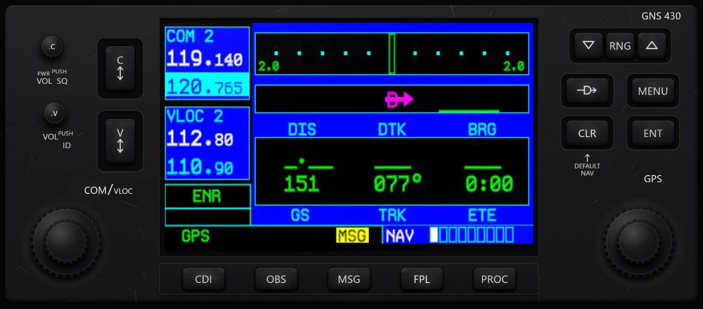

# XPGlassPad

**Turn your iPad (or any tablet) into a touch bezel for the X-Plane 12 G1000 and GNS 430/530 — no popups, no second monitor.**



*G1000 PFD of the default Cessna 172 on an iPad. The screen is the real one from X-Plane, the keys and knobs around it work by touch.*

XPGlassPad is a small X-Plane 12 plugin plus a web app. The plugin reads the real
screen of the built-in avionics straight from the simulator and streams it to your
tablet. You fly the bezel around it — keys, dual concentric knobs, softkeys — by touch.

> Tested on Windows / X-Plane 12.4 with iPad and iPhone. macOS and Linux builds are made
> automatically by GitHub Actions but have not been tested yet — feedback very welcome.

## Screenshots

Captured from the running app with the live X-Plane 12 screen (default Cessna 172 with GNS 530 + GNS 430):

| GNS 530 | GNS 430 |
|---|---|
|  |  |

## Features
- **Automatic device detection** – the plugin asks X-Plane which avionics the loaded
  aircraft uses and the tablet shows the matching unit:
  G1000 PFD 1 / PFD 2 / MFD, GNS 530 #1/#2, GNS 430 #1/#2
- **Real screen, no popups** – captured directly from the device's own render target,
  independent of your camera view
- **Hand-drawn bezels** modelled on the real units, with a slightly used look
- **Dual knobs** – circle on the outer ring for the large knob, in the centre for the
  small knob, tap to push. G1000 RANGE knob: hold + drag = joystick pan
- **Key hold** – e.g. hold CLR for the default map
- Runs in Safari – add it to the Home Screen for a full-screen app. No App Store,
  no extra software on the tablet
- Works with Laminar's default aircraft and add-ons that use the built-in G1000/GNS

## Install
1. Download the latest `XPGlassPad-vX.Y.Z.zip` from
   [Releases](../../releases).
2. Extract it so you get `X-Plane 12/Resources/plugins/XPGlassPad/`.
3. Start X-Plane. Windows may ask about the firewall – allow *private networks*.
4. Look in `X-Plane 12/Log.txt` for a line like
   `XPGlassPad: open on iPad:  http://192.168.1.20:8090/`
5. Open that address in Safari on your tablet → Share → *Add to Home Screen*.

PC and tablet must be on the same network.

**macOS:** if Gatekeeper blocks the plugin, run
`xattr -dr com.apple.quarantine "<X-Plane 12>/Resources/plugins/XPGlassPad"`.

## Controls
| Control | Action |
|---|---|
| Key | tap = press · hold > 0.5 s = press and hold |
| Dual knob | circle on outer ring = large knob · circle in centre = small knob · tap = push |
| G1000 RANGE | circle = zoom · tap = push pan · hold + drag = pan |
| GNS RNG | upper / lower half of the rocker |
| Menu | small bar at the top centre: pick device, click sound, AP keys, stats |

## Settings – `XPGlassPad/config.ini`
| Key | Default | Meaning |
|---|---|---|
| `port` | 8090 | port the tablet connects to |
| `fps` | 20 | max frames per second per display |
| `jpeg_quality` | 80 | 30–95 |
| `readback` | pbo | `pbo` = asynchronous (easier on FPS) · `sync` = direct |
| `watch_timeout` | 3 | seconds without a tablet before capturing pauses |

Capturing only runs while a tablet is actually watching a display.

## Troubleshooting
- `http://<PC-IP>:8090/api/status` shows the loaded aircraft, which devices are bound,
  frame size and readback time (`readMs`).
- Messages from the plugin start with `XPGlassPad:` in `Log.txt`.
- Screen stays on *"Waiting for image"*: please open an issue with your `/api/status`
  output and the `XPGlassPad:` lines from `Log.txt`.

## How it works
- The plugin registers an SDK 4 avionics *draw-after* callback
  (`XPLMRegisterAvionicsCallbacksEx`) for each built-in device and reads the finished
  screen with `glReadPixels` (optionally through a PBO). JPEG encoding runs on a worker thread.
- `XPLMIsAvionicsBound` tells which devices the current aircraft uses.
- A small embedded HTTP server ([cpp-httplib](https://github.com/yhirose/cpp-httplib))
  serves the web app, `/api/status`, `/frame/<device>` (long-poll JPEG) and `/api/cmd`.
- Bezel input is executed as normal X-Plane commands (`sim/GPS/g1000n1_*`,
  `sim/GPS/g430n1_*`, …) on the main thread.

## Build from source
```bash
./build.sh win     # needs mingw-w64 (g++-mingw-w64-x86-64-posix)
./build.sh lin     # needs g++
./build.sh mac     # on macOS with Xcode command line tools
```
Pushing a tag `vX.Y.Z` builds all three platforms on GitHub Actions and publishes a
release ZIP. UI development without X-Plane: `python3 tools/mock.py web pfd1,mfd 8099`.

## License
© E11i0t09 – licensed under [Creative Commons Attribution 4.0 International (CC BY 4.0)](LICENSE).
You may share and adapt it, also commercially, as long as you give appropriate credit.
Bundled third-party code keeps its own license – see [THIRD_PARTY_NOTICES.md](THIRD_PARTY_NOTICES.md).

Garmin, G1000, GNS 430 and GNS 530 are trademarks of Garmin Ltd. X-Plane is a trademark
of Laminar Research. This is an independent fan project, not affiliated with or endorsed by either.
